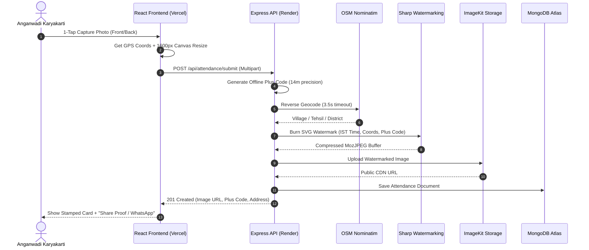

# AVAPS — Anganwadi Verified Attendance Proof System


[](https://nodejs.org/)
[](https://expressjs.com/)
[](https://react.dev/)
[](https://vitejs.dev/)
[](https://tailwindcss.com/)
[](https://www.mongodb.com/)
[](https://render.com/)
[](https://vercel.com/)

---

## 📌 Overview

The **Anganwadi Verified Attendance Proof System (AVAPS)** is a production-grade, mobile-first web utility built to generate indisputable, legally credible evidence of daily physical presence and timely operation at Anganwadi Kendras.

Designed specifically for non-technical Anganwadi workers (Karyakartis) in rural areas with low network bandwidth, AVAPS provides a **one-tap Hindi-first camera workflow** that automatically captures hardware-level GPS, calculates an authoritative server IST timestamp, fetches reverse geocoded village details, generates an offline **Google Plus Code**, and permanently burns a tamper-proof watermark into the photo before storing it in cloud storage.

---

## ✨ Key Features

### 1. 📷 Mobile-First Dual Camera Stream
- **Rear & Front (Selfie) Camera Toggle**: Tap button (`48px+` thumb-friendly target) to instantly switch between primary environment camera and front selfie camera.
- **Natural Mirroring**: Live selfie preview mirrors naturally (`scaleX(-1)`) while the captured canvas frame is un-mirrored to keep background Hindi Kendra boards and text legible.
- **Anti-Blur Optimization**: Off-screen canvas capped at $1600\text{px}$ width maintaining aspect ratio, compressed with MozJPEG at $80\%$ quality for a crisp $\sim 300\text{KB} - 450\text{KB}$ payload.

### 2. 🛡️ Immutable Sharp SVG Watermark (Burn-In Metadata)
Photos are processed purely in-memory using **Sharp** to composite a dynamic, high-contrast SVG banner directly into the bottom of the image:
- **Line 1 (Bold Header)**: Kendra Code & Kendra Name (e.g. `AW-45012 | Anganwadi Kendra Karhi`)
- **Line 2 (White Text)**: Authoritative Server IST Date & Time (e.g. `16 Oct 2026, 09:15:22 AM IST`) — *immune to phone clock tampering*.
- **Line 3 (Yellow Accent)**: Offline Google Plus Code + Reverse Geocoded Address (e.g. `Loc: 7MP3G8P2+FF (Near Primary School, Ward No. 02, Karhi)`)
- **Line 4 (Muted White)**: Raw Latitude & Longitude ($6$ decimal places) + GPS Accuracy (e.g. `GPS: 24.536214° N, 81.301248° E | Acc: ±6.4m`)
- **Status Badge**: Top-right indicator tag (`✓ VERIFIED ON-SITE`, `⚠ PROXIMITY`, or `✕ OUT OF BOUNDS`).

### 3. 🌐 Offline Google Plus Code (Open Location Code)
- Generates a 10-character Open Location Code (e.g., `7MP3G8P2+FF`, $\sim 14\text{m} \times 14\text{m}$ precision) **100% offline and synchronously** via `open-location-code`.
- Eliminates reliance on poorly named rural street addresses and provides a clickable link directly into Google Maps.

### 4. 📍 Real-Time Reverse Geocoding with Fallback
- Queries OpenStreetMap Nominatim with zoom level 18 to construct a clean Indian address hierarchy: `[village / neighbourhood], [tehsil / subdistrict], [district], [state]`.
- Features an `AbortController` timeout ($3.5\text{s}$) with automated fallback to the Kendra's pre-configured ground-truth address.

### 5. 🎯 Haversine Geofencing Verification
- Measures real-time geodesic distance between device coordinates and official Kendra coordinates stored in MongoDB.
- Evaluates geofence status based on configurable radius thresholds ($50\text{m}$, $100\text{m}$, $150\text{m}$).

### 6. ⚡ Zero-Disk In-Memory Cloud Pipeline
- **Multer Memory Storage** $\rightarrow$ **Sharp Composite & MozJPEG** $\rightarrow$ **Direct Stream to ImageKit CDN** $\rightarrow$ **MongoDB Audit Log**.
- No temporary files are ever written to server disk, maximizing execution speed and preventing server disk leaks.

### 7. 📲 1-Tap WhatsApp Proof Share
- Uses the **Web Share API** (with automated WhatsApp deep-link fallback) to share the attendance photo URL and formatted proof message directly to supervisor / CDPO groups with a single tap.

### 8. 🔐 Protected Admin & Kendra Setup (`/admin`)
- Accessible via 4-to-8 digit `ADMIN_PIN` with signed 2-hour JWT session stored in `sessionStorage`.
- Dedicated interface for the supervisor to stand at the Kendra and click **"वर्तमान GPS को केंद्र का स्थान बनाएं"** to lock the ground-truth coordinates.
- Review and audit past attendance records and view original watermarked proofs.

---

## 🏗️ Architecture & Processing Pipeline



---

## 📁 Repository Structure

```text
├── Backend/                        # Node.js + Express API
│   ├── src/
│   │   ├── controllers/
│   │   │   ├── admin.controller.js       # PIN auth, JWT session & Kendra setup
│   │   │   └── attendanceController.js   # Geocoding, Sharp watermarking & upload
│   │   ├── database/
│   │   │   └── db.js                     # MongoDB connection
│   │   ├── middleware/
│   │   │   └── adminAuth.middleware.js   # JWT verification middleware
│   │   ├── models/
│   │   │   ├── attendance.model.js       # Attendance ledger document schema
│   │   │   └── kendraConfig.model.js     # Singleton Kendra ground-truth schema
│   │   ├── routes/
│   │   │   ├── admin.routes.js           # /api/admin routes
│   │   │   └── attendance.routes.js      # /api/attendance/submit route
│   │   ├── service/
│   │   │   ├── geocodingService.js       # OSM Nominatim reverse geocoder
│   │   │   └── imagekit.service.js       # ImageKit cloud SDK client
│   │   └── utils/
│   │       ├── geo.utils.js              # Haversine distance & geofence logic
│   │       └── plusCodeHelper.js         # Offline Google Plus Code generator
│   ├── .env.example
│   ├── package.json
│   └── server.js                         # Application entrypoint
│
├── Frontend/                       # React 19 + Vite Mobile PWA
│   ├── src/
│   │   ├── components/
│   │   │   ├── AdminLogin.jsx            # Secure PIN entry modal
│   │   │   ├── AttendanceFlow.jsx        # Dual-camera capture, GPS & WhatsApp share
│   │   │   ├── BackendStatusBanner.jsx   # Offline indicator banner
│   │   │   ├── KendraSetupPage.jsx       # Kendra ground-truth setup & ledger audit
│   │   │   └── Navbar.jsx                # Responsive header & mobile bottom tabs
│   │   ├── services/
│   │   │   └── api.js                    # Axios client instance
│   │   ├── App.jsx                       # Root app router & tab controller
│   │   └── index.css                     # Claymorphic CSS design system
│   ├── vercel.json                       # Client-side SPA route rewrites
│   └── vite.config.js
│
└── README.md
```

---

## 🚀 Local Development Setup

### Prerequisites
- [Node.js](https://nodejs.org/) (v18 or higher recommended, tested on Node v22)
- [MongoDB Atlas](https://www.mongodb.com/) account or local MongoDB instance
- [ImageKit.io](https://imagekit.io/) free account (for image hosting)

---

### 1. Backend Setup

1. Open your terminal and navigate to `Backend/`:
   ```bash
   cd Backend
   npm install
   ```

2. Create a `.env` file in `Backend/`:
   ```env
   PORT=3000
   NODE_ENV=development
   MONGODB_URI=mongodb+srv://<user>:<password>@cluster0.mongodb.net/anganwadi_db
   CLIENT_URL=http://localhost:5173
   ADMIN_PIN=1234
   JWT_SECRET=avaps_super_secure_jwt_token_secret_anganwadi_2026_x89
   IMAGEKIT_PUBLIC_KEY=public_...
   IMAGEKIT_PRIVATE_KEY=private_...
   IMAGEKIT_URL_ENDPOINT=https://ik.imagekit.io/your_id
   ```

3. Start the backend development server:
   ```bash
   npm start
   ```
   *The server will start on `http://localhost:3000`.* Verify health at `http://localhost:3000/health`.

---

### 2. Frontend Setup

1. Open a new terminal and navigate to `Frontend/`:
   ```bash
   cd Frontend
   npm install
   ```

2. Create a `.env` file in `Frontend/`:
   ```env
   VITE_API_BASE_URL=http://localhost:3000
   ```

3. Start the Vite development server:
   ```bash
   npm run dev
   ```
   *The client will start on `http://localhost:5173`.*

---

## 🌐 Production Deployment

### Step A: Deploy Backend on Render

1. Log in to [dashboard.render.com](https://dashboard.render.com/) and create a **New Web Service**.
2. Connect your GitHub repository.
3. Configure the following settings:
   - **Root Directory**: `Backend` *(⚠️ Critical)*
   - **Build Command**: `npm install`
   - **Start Command**: `npm start`
   - **Health Check Path**: `/health`
4. Add the following **Environment Variables**:
   ```env
   NODE_ENV = production
   MONGODB_URI = mongodb+srv://...
   ADMIN_PIN = your_secure_admin_pin
   JWT_SECRET = your_high_entropy_secret_key
   IMAGEKIT_PUBLIC_KEY = public_...
   IMAGEKIT_PRIVATE_KEY = private_...
   IMAGEKIT_URL_ENDPOINT = https://ik.imagekit.io/...
   CLIENT_URL = https://your-frontend-app.vercel.app
   ```
5. Click **Create Web Service**. Render will assign a public URL (e.g. `https://anganwadi-backend.onrender.com`).

---

### Step B: Deploy Frontend on Vercel

1. Log in to [vercel.com](https://vercel.com/) and click **Add New…** $\rightarrow$ **Project**.
2. Import your GitHub repository.
3. Configure project settings:
   - **Framework Preset**: `Vite`
   - **Root Directory**: `Frontend` *(⚠️ Critical)*
   - **Build Command**: `npm run build`
   - **Output Directory**: `dist`
4. Add Environment Variable:
   ```env
   VITE_API_BASE_URL = https://anganwadi-backend.onrender.com
   ```
   *(Ensure there is no trailing slash at the end).*
5. Click **Deploy**. Vercel will provide your production URL (e.g. `https://your-frontend-app.vercel.app`).
6. Update the `CLIENT_URL` environment variable on Render to match your live Vercel URL so CORS authorization matches.

---

### Step C: Keep-Alive Cron for Render Free Tier (Optional)
Render free tier instances enter sleep mode after 15 minutes of inactivity. To keep your backend awake 24/7 without cold starts:
1. Register at [cron-job.org](https://cron-job.org/) or [uptimerobot.com](https://uptimerobot.com/).
2. Create an HTTP monitor pinging `GET https://your-backend.onrender.com/health` every **10 minutes**.
3. Since `/health` returns a lightweight JSON `{ status: "ok" }` without database queries, it keeps the server active at zero cost.

---

## 🔌 API Endpoints Reference

| Method | Endpoint | Access | Description |
| :--- | :--- | :--- | :--- |
| `GET` | `/health` | Public | Keep-alive uptime ping (`{ status: "ok" }`) |
| `GET` | `/api/kendra-config` | Public | Retrieves Kendra metadata and ground-truth coordinates |
| `POST` | `/api/attendance/submit` | Public | Uploads photo, computes Plus Code, stamps watermark, uploads to ImageKit & saves to MongoDB |
| `POST` | `/api/admin/login` | Public | Validates PIN against `ADMIN_PIN` and returns signed 2h JWT |
| `GET` | `/api/admin/kendra-config` | JWT Protected | Fetches active Kendra configuration for administrative review |
| `POST` | `/api/admin/kendra-config` | JWT Protected | Sets official Kendra coordinates, address, and allowed radius |
| `GET` | `/api/admin/attendance-records` | JWT Protected | Lists verified attendance ledger records with filter options |

---

## 🔑 Environment Variables Reference

### Backend (`Backend/.env`)
| Variable | Description |
| :--- | :--- |
| `PORT` | Local port number (Default: `3000`). Auto-injected on Render. |
| `NODE_ENV` | Environment mode (`development` or `production`). |
| `MONGODB_URI` | Full connection URI to MongoDB database. |
| `CLIENT_URL` | Frontend origin allowed by CORS policy. |
| `ADMIN_PIN` | Admin authentication PIN for Kendra setup and ledger review. |
| `JWT_SECRET` | Secret key used to sign and verify Admin JWT session tokens. |
| `IMAGEKIT_PUBLIC_KEY` | Public key from ImageKit developer settings. |
| `IMAGEKIT_PRIVATE_KEY` | Private key from ImageKit developer settings. |
| `IMAGEKIT_URL_ENDPOINT` | URL endpoint from ImageKit developer settings. |

### Frontend (`Frontend/.env`)
| Variable | Description |
| :--- | :--- |
| `VITE_API_BASE_URL` | Base URL of the backend API (e.g., `http://localhost:3000` or Render URL). |

---

## 🔒 Security Best Practices

1. **No Client-Side Secrets**: ImageKit Private Keys, MongoDB URIs, and Admin PINs are strictly isolated to backend runtime memory.
2. **Authoritative Timestamping**: The attendance timestamp is generated strictly on the server in IST (`Asia/Kolkata`), preventing users from spoofing device clocks.
3. **Hardware-Enforced Cameras**: Only live camera capture streams are accepted; file picking is prevented in standard operational flow.
4. **Session-Scoped JWTs**: Admin tokens expire after 2 hours and are kept strictly in `sessionStorage` (automatically cleared on browser close).

---

## 📄 License

This project is licensed under the **MIT License**. Built with ❤️ for empowering rural healthcare and early childhood development workers across India.
